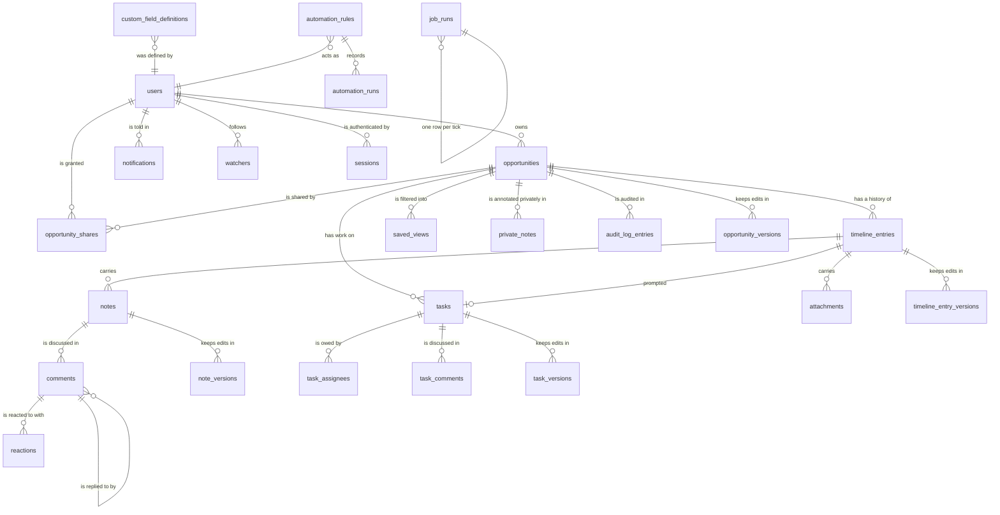
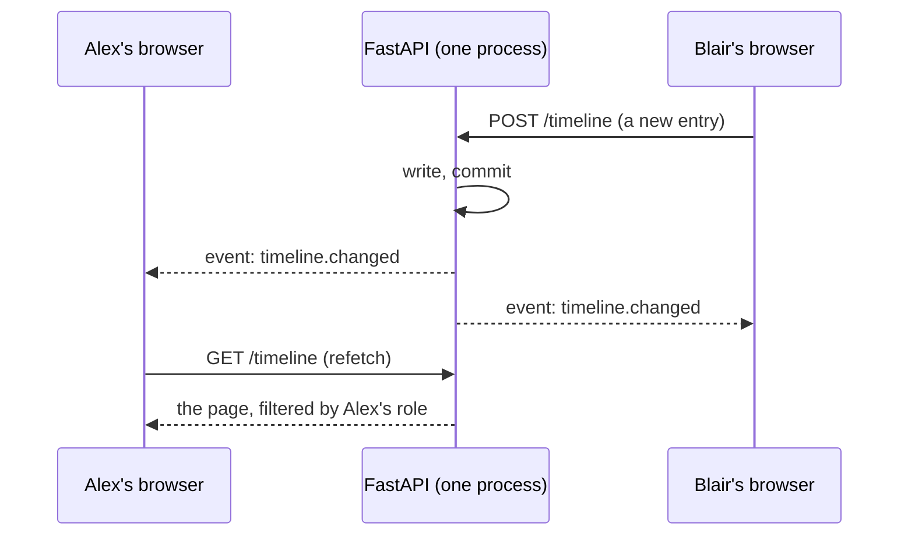

# OppTrail v2 — Architecture

Companion to the ADRs in `docs/adr/`. This document states the shape of the system
and the cross-cutting standards; the ADRs carry the reasoning for each choice.

## The decision that shapes everything else

Confirmed target scale: **20 users, 20 opportunities each (400 total), ~200 entries
per opportunity, 2-3 concurrent**. That is **~800,000 rows and a ~136 MB database**
— seeded and benchmarked, not estimated.

This is small, and saying so plainly is the most useful thing this document does.
It means the infrastructure half of a "ClickUp-class" brief — Postgres, a message
broker, a job queue, object storage, a multi-tenant hierarchy — is not merely
premature but actively harmful here: it would consume the entire v2 budget building
scaffolding for load that will not arrive, while the actual gap (interaction
quality) went unaddressed.

The v2 goal is therefore restated as: **ClickUp-class interaction quality on
deliberately boring infrastructure.**

## Target architecture

```
                     one Docker container
  ┌──────────────────────────────────────────────────────────┐
  │  FastAPI (single process, single instance)               │
  │                                                          │
  │   /            static React bundle (built by Next.js)    │
  │   /api/*       JSON API, session cookie auth             │
  │   /api/.../events   SSE invalidation stream    ADR 0003  │
  │                                                          │
  │   APScheduler  digests, reminders, IMAP poll,  ADR 0004  │
  │                backups                                   │
  │   OpenAI       read-only agent, no tools       ADR 0012  │
  └───────────────┬──────────────────────────────────────────┘
                  │
        /data volume
          app.db          SQLite + WAL + FTS5    ADR 0001, 0007
          attachments/    content-addressed      ADR 0008
          backups/        VACUUM INTO snapshots  ADR 0011
```

Unchanged from v1: one image, one process, one volume, one origin. No CORS, no
reverse proxy, no service discovery, no broker.

### Frontend

React SPA, routed client-side, built by Next.js in static-export mode. Next is
**explicitly a build tool** — no SSR, no server components, no API routes
(ADR 0005). Deep links work because FastAPI serves `index.html` for any unmatched
path (`main.py:56-64`).

- **React Router** — URL is the source of truth for opportunity, view, and
  filters. Milestone 2.2 made that literal: each view state is namespaced by
  its entity (`opportunities.stage`, `timeline.order`) so the board and the
  open timeline can both keep their state in one query string, and a saved
  view is a named copy of those parameters (`lib/viewState.ts`,
  `backend/app/routes_saved_views.py`).
- **TanStack Query** — the only server-state cache; SSE events invalidate keys.
- **Editing in place** — a field is edited where it is read rather than in a
  form elsewhere on the page (`AGENTS.md` v2 scope item 12, milestone 2.11).
  `app/InlineEdit.tsx` holds the two shapes of it and the focus rule that
  returns the reader to where they were; `lib/domain.ts`'s
  `editableOpportunityFields` declares each field once for every surface that
  edits it, and every one of those writes is a partial `PATCH` through
  `useEditOpportunity`. No route changed for it: the update routes already
  applied exactly the fields they were given, and versioned the result
  (milestone 2.10).
- **Keyboard map** — one declaration (`lib/keyboard.ts`) serves both the `?`
  reference screen and the `Chord` union the views bind against, so a
  documented key that nothing answers is a type error (milestone 2.4a). Each
  view binds only the chords it can act on; single keys stop at a text field,
  `Ctrl K` and `Esc` deliberately do not.
- `app/[[...slug]]/page.tsx` is the single exported HTML file; `app/AppRoot.tsx`
  holds the router and the query client, and `/search` is the second route that
  justified introducing both (milestone 1.5). Milestone 2.1 decomposed the
  former `page.tsx` into routed views and feature components, and milestone
  R.1 settled the shape they sit in: `app/AppShell.tsx` is the layout route
  every screen renders inside — a collapsible rail of destinations, the
  application bar, and the session resolved once — with the board at `/` and a
  deal at `/opportunities/:opportunityId` as siblings rather than parent and
  child (**D-188**, **D-191**). Every server read and write is declared in
  `lib/queries.ts`. Local state lives in the component that owns it.

### Backend

Keep the current module shape — it is sound. Additions:

- `deps.py` — the `OpportunityContext` dependency that makes authorization
  structural rather than conventional (ADR 0010).
- `search.py` — FTS5 index maintenance and query (ADR 0007).
- `email_inbound.py` / `email_outbound.py` — parsing behind a transport interface
  (ADR 0009).
- `jobs/` — scheduled tasks, framework-free so they stay directly testable.
- `attachments.py` — validation, content addressing, streamed download (ADR 0008).
  Shipped in milestone 4.3 as three modules rather than one: `uploads.py`
  (the rules and the content addressing, stood up in Phase F milestone F.5),
  `routes_attachments.py` (the four routes and the permission boundary) and
  `attachment_utils.py` (the row read the timeline and the export share).
- Alembic replaces `schema.sql` + `run_migrations()` (ADR 0002).

## Cross-cutting standards

### Authorization

One rule: **no endpoint touches an opportunity-scoped object without passing through
the `OpportunityContext` dependency.** Routes declare the level they need; nested
objects resolve to their opportunity inside the dependency. A route test enumerates
the app's routes and fails the build if any non-public route omits the guard
(ADR 0010).

### Timestamps

All timestamps are canonical fixed-width UTC (`%Y-%m-%dT%H:%M:%SZ`, `time_utils.py`).
Lexicographic comparison must remain equal to chronological comparison. No
`CURRENT_TIMESTAMP`, ever — every v2 migration and insert path inherits this.

### Untrusted input

Content arriving by email or attachment is **untrusted** and must be labelled with
its provenance everywhere it travels: in the database (`source`), in the UI, and in
the AI context (ADR 0012). This is new in v2 and is the single largest change to the
system's threat model.

### Error shapes

One envelope for every failure: `{"error": {"code", "message", "fields"?}}`.
Hand-raised errors used to be `{"detail": "..."}` while Pydantic emitted
`{"detail": [...]}`, and the client flattened every 422 to "Request failed" — so
users never learned which field was wrong. A single exception handler normalizes
both (`backend/app/errors.py`). Since milestone 2.9 removed v1 this is the only
shape the API answers with, so `is_api_path` now separates the API from the page
routes this process also serves rather than one version from another.

### Live updates

One SSE stream per open opportunity, `GET /api/v2/opportunities/{id}/events`,
carrying **invalidations** rather than payloads (ADR 0003, milestone 3.4).
`backend/app/events.py` is an in-process broker — no message bus, which is the
assumption ADR 0001 and ADR 0011 already make — and `frontend/lib/liveUpdates.ts`
maps each event onto TanStack Query keys. Nothing about a row's shape or its
visibility is decided on this path, so the push transport can never disagree
with the read API.

Four rules hold it together: an event is published only after the write's
`commit()`; an invalidation may be broader than the write behind it and never
narrower; each subscriber's queue de-duplicates, so a slow reader costs bounded
memory and one refetch rather than many; and a stream closes itself after
`SSE_MAX_CONNECTION_SECONDS` with a `retry:` advertised, so the browser
reconnects and no intermediary is left reaping a connection the server still
believes in. A reconnect is a gap, so the client refetches on every `ready`
after the first.

The conflict model is last-write-wins with an **edit guard** on notes, not
CRDTs or OT: `PATCH /api/v2/notes/{id}` requires the `updated_at` the editor
was opened against and answers 409 if it has moved. Nothing is lost when it
does — `note_versions` holds every recorded state (invariant 8) — and comments
are immutable while entries are rarely co-edited, so the note is the only body
that needed one.

### Pagination

Every collection endpoint is paginated from the start: `?limit&cursor`, returning
`{"items": [...], "next_cursor": null}`. Not for load — for the fact that adding it
later breaks every client. Ship it before the view layer is built (review blocker
B3).

### API versioning

New surface mounts under `/api/v2`. `/api/*` served v1 shapes until the frontend
had moved, then was removed — milestone 1.3 opened the boundary with the
paginated collection reads and the error envelope, milestone 2.9 ported the
remaining mutations and single-resource reads, moved the frontend and deleted
v1. Pagination and the notification rework are both breaking, so a version
boundary is what made them incremental.

Everything the client calls is `/api/v2/*` today. Three operations endpoints
are deliberately outside it, because a probe is not part of the surface a
version boundary exists to move (D-094) — and they answer three different
questions (R.4, **D-203**): `/healthz` is liveness and does no I/O,
`/readyz` is readiness and answers with a status code, which is what the
container's `HEALTHCHECK` reads, and `/api/health` is the richer report a
person or a dashboard reads. `scripts/docker-smoke.sh` exercises all three
against the real image.

Because every collection read is paginated and four of the frontend's reads want
the whole set — the opportunity list, a timeline, a share list, an audit log —
`lib/queries.ts`'s `fetchAll` follows `next_cursor` to the last page rather than
pushing the cursor into the views (D-093).

## The data model

Written in milestone R.8 against the shipped schema (22 revisions), not the
plan. Soft-delete and audit tables are omitted from the diagram and described
below it, because every content table carries `deleted_at` and drawing twelve
of those adds nothing.



Five properties of this shape are load bearing:

- **One root.** Everything a person writes hangs off an opportunity, directly
  or through an entry. There is no workspace, team or tenant above it (ADR
  0010), which is what keeps authorization to one function and one test matrix.
- **The timeline is the spine**, and the nesting stops at four levels:
  opportunity → entry → note → comment → one reply. A deeper tree was possible
  in the schema and is refused by the route, because a discussion that indents
  four times is the thing `resolve` exists to prevent.
- **Nothing is deleted.** Every content table has `deleted_at`, every read
  filters it at each level it joins through, and one delete writes one stamp
  across a whole subtree so the matching restore can ask for exactly that value
  back. `sessions`, `reactions` and `watchers` are the three exceptions, and
  each is toggle state rather than content.
- **Every edit is kept.** Four `*_versions` tables, one shape: a whole snapshot
  per write rather than a diff, so a partial `PATCH` still records complete
  state and no reader has to reconstruct one from a chain with a gap in it.
- **Two JSON columns, both validated on write.** `custom_values` on
  opportunities and entries (ADR 0006) and the trigger/action/condition
  parameters on `automation_rules`. Neither is trusted on read: a value whose
  definition has been archived is dropped from the answer, which is what lets a
  field be archived without rewriting a row.

## The authorization model

Three roles and no fourth: **owner** (implicitly, via
`opportunities.owner_id`), **editor** and **viewer** (rows in
`opportunity_shares`). Every route resolves the caller's role from the database
through `app/permissions.py` — never from the client — and the four gates are:

| Gate | Means | Used by |
|---|---|---|
| `require_opportunity_access` | any role | reads, the AI, the member list, a private note |
| `require_timeline_write` | not a viewer | writing an entry, note, comment, reaction |
| `require_author_or_owner` | wrote it, or owns the deal | editing or deleting an existing item |
| `require_opportunity_owner` | owns the deal | the record, sharing, audit log, version history |

Four consequences worth stating:

- **Absence of access is 404, not 403.** Opportunity existence is itself not
  public. 403 is reserved for "you can see this and may not do that", which is
  why a shared editor gets 403 from an owner-only route and a stranger gets
  404.
- **Editing and deleting are the same rule**, resolved through one function, so
  they cannot drift apart again — they had, and the human overruled the
  permissive reading (D-005).
- **A private entry is narrower than any role** (R.1b): readable by its author
  alone, including against the deal's owner, enforced by one predicate
  (`permissions.VISIBLE_ENTRIES_SQL`) applied to every read that could return
  one. `tests/test_entry_visibility.py` is the actor the role matrix cannot
  express — somebody who may read the deal and may not read one entry on it.
- **Two routes are deliberately wider.** Watching a deal answers for any
  signed-in caller, because following a deal you are not shared on is the
  feature; it grants no read access. And defining a custom field is open to any
  authenticated caller, because `FEATURES.md` says "admin-defined" and this app
  has no admin role, so the record of who defined it is the accountability
  instead (D-171).

`tests/test_authorization_matrix.py` is every endpoint × {owner, editor,
viewer, unrelated, anonymous}, read from the running app — **a new route with
no entry fails the build**.

## Real-time design

`GET /api/v2/opportunities/{id}/events` is ADR 0003: one long-lived
`text/event-stream` per open timeline, carrying **invalidations and never
payloads**. The server says `{"type":"timeline.changed","opportunity_id":7}`
and the client refetches through the ordinary paginated reads, so nothing about
what a row contains or who may read it is decided twice.



- **Two event types, and one is a superset.** `timeline.changed` covers
  anything hanging off the timeline; `opportunity.changed` covers the record,
  its stage, sharing, ownership and watchers — and also invalidates the
  timeline, because most writes to a record leave a system entry there and the
  event does not say whether this one did. An invalidation may be broader than
  the write behind it and never narrower.
- **Published after `commit()`.** A subscriber's only reaction is to read
  again; an event sent from inside the transaction sends them to fetch the
  state it is about to replace.
- **The queue de-duplicates**, which is what bounds it: two writes a
  millisecond apart are one refetch, and a slow reader cannot grow the writer's
  memory. Sound only because these are idempotent invalidations carrying
  nothing a dropped duplicate would lose.
- **A stream ends itself** after five minutes having advertised a `retry:`, so
  no intermediary gets to reap a connection the app still believes in. A
  reconnect is a *gap*, so the client refetches on every reopen.
- **A revoked role is not re-checked mid-stream.** The reader keeps receiving
  invalidations, and the refetch each one provokes is the read that answers
  404. No content travels this path either way.

The AI's streamed answer is a different shape on purpose: a POST, because the
question is in the body, carrying content rather than invalidations (D-187).

## The AI read-only guarantee

ADR 0012, and it is a property of the plumbing rather than a promise in a
prompt. Four independent mechanisms:

1. **`PRAGMA query_only = ON`.** `routes_ai` opens
   `database.read_only_connection()`, so SQLite itself raises on any write from
   that path no matter what the calling code, the prompt or the model's answer
   says. A pragma rather than a `mode=ro` URI because the database runs in WAL.
2. **No tool surface.** The model is handed a question and a block of text and
   can call nothing. `tests/test_ai.py::test_invariant_ai_agent_has_no_write_tools`
   is a source scan, not a behavioural test.
3. **The context is labelled, and the labels are unforgeable.** Every body is
   fenced between `[BEGIN USER TEXT <token>]` and `[END USER TEXT <token>]`
   with a token drawn per request, and every value that sits on a structural
   line — a title, an author, a filename — is flattened to one line. A fixed
   marker would be a string somebody could type into a note.
4. **It reads only what the asker may read.** The context is assembled per
   reader, which is the one place a leak would be invisible: a private entry is
   absent from everyone's context but its author's, and a viewer may ask
   questions because the route is `require_opportunity_access`.

What the guarantee does **not** cover, stated plainly: the model's obedience to
the instruction that it cannot read inside an attachment. That is behaviour, the
test suite forbids live network calls, and a human checks it at the gate — which
is how the Phase 4 review found the model answering truthfully from the timeline
while never mentioning it had not opened the file (D-169).

`store=False` on every call, so nothing is retained by the provider.

## Testing strategy

The existing shape is right and should be extended, not replaced: integration tests
driving the real app through `TestClient` against a real SQLite file catch the bugs
that matter here, and they already cover the role matrix per resource.

| Layer | Tool | Scope | Target |
|-------|------|-------|--------|
| Unit | pytest | Pure logic: timestamps, email parsing, quote stripping, CSV escaping, custom-field validation | Fast, exhaustive on edge cases |
| Integration | pytest + `TestClient` | Every endpoint, every role, soft deletes, audit rows, pagination | **The bulk of the suite.** ≥90% of `backend/app` |
| Frontend unit | Vitest + Testing Library | Components with logic: filter builder, editor, views | ≥70% of `frontend/src` |
| E2E | Playwright | 5-8 critical flows only: sign in, create opportunity, log entry, share, search, export | Kept small deliberately |
| Security regression | pytest | Route-guard enumeration, path traversal, CSV injection, prompt injection, email spoofing | Every fixed vulnerability keeps its test |

Two rules the suite has already been bitten by, carried forward from `CLAUDE.md`:
assertions must not depend on the wall clock, and a guard test must be shown to fail
against the unfixed code before it is trusted.

## CI

There is none today — 39 tests that nothing runs (review blocker B4). GitHub Actions,
on every push and PR:

1. `uv run pytest --cov=app` with a coverage floor that fails the build.
2. `npm run typecheck`, `npm run lint`, `npm run test`.
3. `docker build`, then the backend suite **inside the image** — this is where
   WeasyPrint actually runs, and it already catches what the host cannot.
4. Playwright smoke against the built container.
5. Alembic check: migrations apply cleanly to an empty database *and* to a restored
   snapshot of the previous release's schema.

Step 5 is the one that protects the existing `data/app.db` from a bad migration, and
it is the reason ADR 0002 is a blocker rather than a nicety.

## Observability

Review H3 ("currently zero") is closed by F.2 and milestone 1.6. What remains
splits in two since email moved to v3 (**D-141**): the job-outcome half arrives
with Phase 6's scheduler, and the ingestion half is v3's, with ADR 0009.
Minimum viable, no vendor:

- **Structured JSON logs to stdout** with a request ID, route, status and
  duration (`logging_utils.py`, F.2). `routes_ai.py`'s OpenAI-call exception
  handler logs the cause via `exc_info` rather than discarding it.
- **Audit log stays separate.** It is a product feature for owners, not operations
  telemetry; do not conflate them.
- **`/api/health` reports substance** (milestone 1.6, `app/backup.py`,
  `main.py`'s `health_check`): schema version read from `alembic_version`,
  database writability (a `BEGIN IMMEDIATE` probe that rolls back), and the
  last successful `VACUUM INTO` backup's timestamp. IMAP poll status is added
  once ADR 0009 lands, which is v3.
- **Job outcomes recorded** in the job table — a silently dead scheduler is
  the most likely v2 production failure, and the reason this is not deferred with
  the email work: Phase 6 schedules automations and backups, so v2 does have a
  scheduler to lose track of. **Shipped in milestone 6.5** (ADR 0004):
  `job_runs` holds one row per execution, written on *start* and updated on
  finish, so a row left at `started` is a process that died mid-job. Read in
  two places (**D-183**) — `/api/health`'s `jobs`, the newest run of each job,
  for whatever watches the container; and `GET /api/v2/job-runs`, which the
  automations screen turns into one line, because the only place a stopped
  scheduler is *felt* is the screen where somebody is wondering why their rule
  has not fired. The durable `outbox` is still v3's, with the first thing that
  sends.
- **Inbound email ingestion log**, including rejections — **v3**, with ADR 0009.
  Silent drops are unacceptable when a colleague believes they filed a note.

## Performance budgets

Concrete numbers, measured in CI against a seeded database at 2x target scale
(40 opportunities, 400 entries each):

Measured on a seeded database at exactly this scale (800,400 rows). Where a figure
was measured it is shown; the rest are targets.

| Operation | Budget (p95) | Measured today |
|-----------|--------------|----------------|
| Timeline load, 200 entries with notes and comments | **400 ms** API, **800 ms** to interactive | 1.4 ms (query) |
| Dashboard load, 400 opportunities with stalled state | **300 ms** API | 131 ms |
| View switch (timeline ↔ board ↔ table), data cached | **150 ms** | n/a (not built) |
| Keyword search across all opportunities | **300 ms** | 294 ms worst case (LIKE), 1-121 ms (FTS5) |
| Filter/sort change within a loaded view | **100 ms** | n/a |
| Entry create → visible to a second user via SSE | **2 s** | n/a |
| AI answer, complete | **15 s** (streamed, first token < 3 s) | n/a |
| PDF export, 200 entries | **5 s** | n/a |
| Initial JS bundle | **250 KB** gzipped | n/a |

Two things the measurements changed:

- **The dashboard N+1 passes.** 131 ms at 400 opportunities, well inside budget, and
  the obvious "single grouped query" rewrite measured **363 ms — three times
  slower**, because it unions all 800,000 rows instead of using the
  `opportunity_id` index. Do not apply that fix. If the dashboard ever needs to be
  faster, denormalize `last_activity_at` onto `opportunities`.
- **FTS5 is justified on worst-case latency and UX, not on raw speed.** `LIKE` is
  fast when matches are dense (it short-circuits on `LIMIT`) and slowest exactly
  when the user searches something specific: 294 ms for a term with no matches,
  against a 300 ms budget. FTS5 inverts that — 1 ms for a rare term — and adds
  ranking and snippets, which `LIKE` cannot provide at any speed.

Budgets are enforced in CI against a seeded database at this scale, so a regression
fails the build rather than being discovered in use.

## Accessibility target

**WCAG 2.2 AA**, treated as a build requirement rather than a later audit — the
current app has one `aria`/`role` attribute in 1,829 lines, so this starts from zero.

- Every interactive element reachable and operable by keyboard, with a visible focus
  ring. Dense, keyboard-first UI is a stated v2 goal, which makes this load-bearing
  rather than compliance theatre.
- Real dialogs with focus trap and restore, replacing `window.confirm`.
- Live regions for async results and toasts.
- 4.5:1 contrast for text. **Measured against the current palette, three in-use
  pairs already fail** and need corrected tints in the token set: accent teal as
  link text is 3.38:1 (`globals.css:89,808`), alert red as error text is 4.38:1
  (`:231,:246`), and white on the red notification badge is 4.38:1 (`:266`). Slate
  gray passes at 4.58:1, and dark-on-amber badges pass at 7.72:1 — the brand colours
  are fine as fills, and unsafe as text. `DESIGN-SYSTEM.md` carries the fix.
- Never colour alone to convey meaning: entry types and stage badges need shape or
  text too.
- `axe` assertions in Playwright runs, so regressions fail CI.
